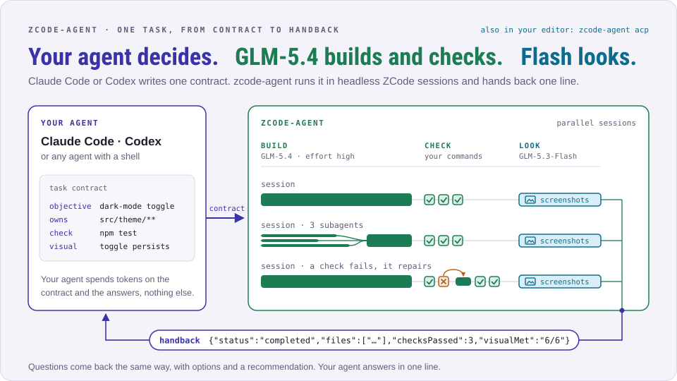
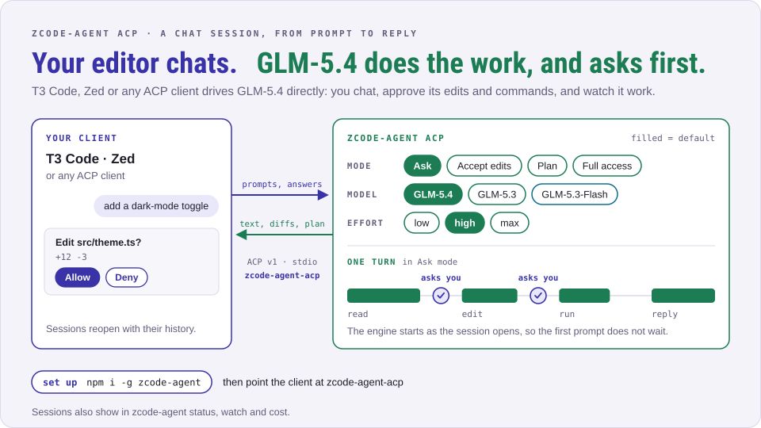

<p align="center">
  <picture>
    <source media="(prefers-color-scheme: dark)" srcset="https://raw.githubusercontent.com/0xgeorgemathew/zcode-agent/main/docs/assets/hero-dark.svg">
    
  </picture>
</p>

<p align="center">
  <a href="https://www.npmjs.com/package/zcode-agent"></a>
  
  
  <a href="https://github.com/0xgeorgemathew/zcode-agent/blob/main/LICENSE"></a>
</p>

# zcode-agent

zcode-agent is a command-line executor for any agent that can run a shell command: Claude Code, Codex, or your own. Your agent makes the decisions and writes a task contract. zcode-agent builds it with **GLM-5.4**, runs your checks itself, repairs what fails, and has a separate GLM-5.3-Flash session that never saw the code judge screenshots of the result. It hands back one line of JSON, so your agent's expensive tokens go to decisions and exceptions, not to reading diffs, re-running tests or opening screenshots.

| | does | never does |
|---|---|---|
| **Your agent** | product, design and logic decisions; splits the work; answers questions | writes code, re-runs checks, looks at screenshots |
| **zcode-agent** (GLM-5.4 by default) | builds inside the paths it owns, runs subagents in parallel, runs the checks, fixes failures | invents anything user-visible the decisions left open, commits, deploys |
| **The verifier** (a fresh GLM-5.3-Flash session) | serves the app, screenshots every viewport, quotes the text it can read, judges each criterion | edits files, trusts the DOM over the pixels |

It is also an [ACP](https://agentclientprotocol.com) agent: `zcode-agent acp` lets you chat with GLM-5.4 directly in T3 Code, Zed or any other Agent Client Protocol client. See [Use it in T3 Code, Zed or any ACP client](#use-it-in-t3-code-zed-or-any-acp-client).

&nbsp;

## Quick start

```sh
# check engine, key, MCP, browser
npx zcode-agent doctor

# teach Claude Code and Codex
npx zcode-agent skills install

# or hand it a task yourself
npx zcode-agent task \
  --check "npm test" \
  "Fix the off-by-one in paginate.ts"
```

To skip `npx`, install it once with `npm install -g zcode-agent`. It needs Node 22.13 or later and runs on macOS and Linux. Windows is not supported: checks run through `/bin/sh` and rely on POSIX process groups.

**With the ZCode app installed, there is nothing to configure.** zcode-agent reads the app's Z.ai API key where the app stores it (it never prints it) and gives every session the app's MCP servers and skills. Two kinds of server are left out: remote ones that sign in with OAuth, because a headless session can't complete the sign-in, and any that failed to connect in the last six hours (twice as long after each further failure, up to four days). The app's plugins, agent profiles and your global `AGENTS.md` stay out unless you pass `--inherit-desktop`. `--hermetic` leaves out the app's MCP servers and skills too; the Playwright browser server stays until you add `--no-browser`.

**Without the app**, set an API key and install a browser for visual checks:

```sh
# the key, in the environment
export ZAI_API_KEY=...
# or stored once
printf %s "$KEY" \
  | npx zcode-agent login

# Chromium for visual checks
npx zcode-agent doctor \
  --install-browser
```

The engine comes with the package. `@zcode-agent/engine` is the headless ZCode engine, built unmodified from the Apache-2.0 source of [zai-org/ZCode](https://github.com/zai-org/ZCode) and pinned to the version zcode-agent is tested with.

`zcode-agent skills install` copies the Claude Code skill to `~/.claude/skills/zcode-agent` and the Codex skill to `${CODEX_HOME:-~/.codex}/skills/zcode-agent`, and removes a pre-1.0 `zcode` skill if it finds one. `zcode-agent skills install claude` or `codex` installs one of them, `zcode-agent skills` shows what is installed, and `zcode-agent skills uninstall` removes both. The package runs no install scripts. The skills themselves are in [`packages/cli/skills`](https://github.com/0xgeorgemathew/zcode-agent/blob/main/packages/cli/skills/README.md).

&nbsp;

## Models

Every command runs on **GLM-5.4** at effort `high` unless you say otherwise, on the command line and in `zcode-agent acp` alike.

| model | `--model` | context | reads images | use it for |
|---|---|---|---|---|
| **GLM-5.4** (default) | `glm-5.4`, `5.4`, `54` | 1M tokens | yes | everything, unless you have a reason not to |
| GLM-5.3 | `glm-5.3`, `5.3`, `53` | 1M tokens | no | the previous flagship, when you need its behaviour |
| GLM-5.3-Flash | `glm-5.3-flash`, `flash`, `5.3-flash`, `53f` | 200K tokens, as the engine runs it | yes | cheaper, faster work; it is also the visual verifier |

GLM-5.4 is Z.ai's newest model, released on 23 November 2026. Unlike GLM-5.3 it reads images, so the executor can look at its own screenshots and at images you attach. The independent visual verifier stays on GLM-5.3-Flash, the cheapest model that can see, so `--visual` costs the same whichever model builds.

`--effort` takes `low`, `high` (default) or `max` on all three models. A task contract can set `"model"` and `"effort"`, and flags override it; a plan sets them in the plan file. A resumed session keeps its model and effort unless you pass the flags again. Any other model, or an effort the model does not accept, exits 2 before anything starts.

<details>
<summary><b>How GLM-5.4 runs on the bundled engine, and what was measured</b></summary>

&nbsp;

The bundled engine (ZCode 0.16.9) predates GLM-5.4, and so does every ZCode release so far: their built-in Z.ai provider lists only GLM-5.3 and GLM-5.3-Flash, and the engine refuses a model it does not know. zcode-agent therefore registers GLM-5.4 itself, in each session's own provider config, the way the ZCode app registers a model you add by hand: the id goes on the Z.ai provider with a rule giving its context window, image input, reasoning levels and how a level is sent to the API (the mapping GLM-5.3 uses). Your ZCode app's files are never changed. When an engine ships that lists GLM-5.4, zcode-agent stops registering it and uses the engine's own settings.

Checked against Z.ai's API on release day, since Z.ai has not published a model page yet:

- The API serves the id `GLM-5.4`, and the engine runs it through this registration, with the ZCode app's config and with none (`npm run test:live`).
- It reads images: it returned the number written in a generated PNG. GLM-5.3 could not.
- It accepted a 521,000-token prompt, so the window is well past 200K. Z.ai's plan pages label it 1M, which is what zcode-agent reports.
- The API accepts up to 131,072 output tokens. zcode-agent registers the engine's GLM-5.3 limit of 128,000.
- Reasoning levels are registered as `low`, `high`, `max`, the levels GLM-5.3 has. The API does not reject other values for GLM-5.4, so this cannot be read from it.
- Z.ai has published no API price. See [Cost](#cost).

`zcode-agent doctor` shows the levels and image support in use for each model.

</details>

&nbsp;

## How a task runs

With the skill installed, your agent works in four steps. Only the first one costs much.

1. **Decide.** Read the repo, then write down every user-visible and behavioural decision once, as short statements in a file such as `docs/decisions.md`: palette, copy, motion, validation rules, storage keys.
2. **Shape.** One session, one session with units, parallel sessions, or a plan. [Split work only when it splits](#split-work-only-when-it-splits) says which.
3. **Dispatch and wait.** One background `zcode-agent wait` or `zcode-agent plan wait`, with no polling.
4. **Handle exceptions.** A `completed` session needs nothing. Any other status comes with the questions, the tail of the failing check, or the unmet criterion, and your agent answers with a one-line `zcode-agent resume`.

You can watch sessions while they run. Your agent doesn't need to.

```text
$ zcode-agent watch
api-auth  completed  22m  last: Bash 3m ago  req 61  sub 0  $0.09~
settings-page  running verifying round 1  31m  last: Read 4s ago  req 84  sub 2  $0.14~
billing-page  running executing  31m  last: Edit 12s ago  thinking 40s 2.1k chars  req 77  sub 3  $0.12~
total  $0.35~  (3 sessions, Z.ai list price; ~ = estimate)
```

A line says `thinking` or `writing` while a model request streams, so a long request doesn't look stuck. A running session with no engine event for 8 minutes gets `STALLED?` (`--stall-min` changes the threshold); nothing happens automatically. `~` marks an estimated amount, which today includes every GLM-5.4 session (see [Cost](#cost)).

&nbsp;

## Hand off a task

```sh
zcode-agent task --cwd ./site --id pricing \
  --owns src/pages/pricing/ \
  --check "npm run build" --check "npm test -- pricing" \
  --decisions @docs/decisions.md \
  --visual "all three plan cards are readable side by side at 1440 and stacked at 390" \
  "Build the pricing page"
```

zcode-agent turns the flags into a task contract and runs a fresh engine session with `--cwd` as the limit of what it may touch. The executor may split the work across subagents. When it finishes, zcode-agent runs the checks itself and feeds any failure back for up to two repair turns (`--max-repairs`). With `--visual`, a fresh session then serves the app, screenshots it and judges each criterion. The summary looks like this:

```text
✓ completed  pricing  552.3s
  Pricing page with three plan cards; the middle card is highlighted.
changed  3 files
  A src/pages/pricing/index.tsx
  A src/pages/pricing/PlanCard.tsx
  M src/pages/pricing/styles.css
checks   2/2 passed
  ✓ npm run build
  ✓ npm test -- pricing
visual
  - met all three plan cards are readable side by side at 1440 and stacked at 390 @1440x900
  - met all three plan cards are readable side by side at 1440 and stacked at 390 @390x844
```

The summary goes to stdout and the live feed (phases, tools, subagents, check results) to stderr. With `--json`, stdout carries NDJSON events and then one machine-readable result line, and `--quiet` leaves only the result line (see [Machine interface](#machine-interface)). For a small fix the objective alone is enough: `zcode-agent task "Fix the typo in the README heading"`.

**Checks** are shell commands zcode-agent runs in `--cwd` after the work, with `CI=1` set unless you set it. A check is over when its shell exits, and anything it left running in the background (a preview server started with `&`) is stopped with it. Each check gets `--check-timeout-ms`, or the time the run has left if that is less.

### What a status means

| status | meaning | exit |
|---|---|---|
| `completed` | zcode-agent's own checks passed, the executor reports done, no criterion is unmet and nothing changed outside `--owns` | 0 |
| `unverified` | nothing confirms the work: there were no checks to run, or the checks passed but the executor gave no usable "done" report | 9 |
| `partial` | work remains: the executor says so, a criterion is unmet, or files changed outside the owned paths | 8 |
| `blocked` | the executor needs an answer; `questions` lists them with options and a recommendation | 10 |
| `failed` | checks still fail after the repair turns (8), the engine or turn failed (5), the run ran out of time (124), or it never started (no key 3, engine missing 4) | 3, 4, 5, 8, 124 |
| `cancelled` | stopped by `zcode-agent cancel`, Ctrl-C, SIGTERM or a closed terminal (SIGHUP) | 130 |

zcode-agent derives the status from what it observed, not from what the model claims. The model's own report is kept as `handback`, and `notVerified` lists anything zcode-agent could not check itself. `--timeout-ms` covers the whole run: engine start, the work, checks, repairs and the verifier. Running out anywhere is exit 124, and `zcode-agent resume <id> "continue"` picks up from the files already written.

### The contract

Flags cover the common fields. For a larger handoff, pass `--task contract.json`, `--task brief.md`, or `--task -` to read stdin. Only `objective` is required. Unknown keys and entries of the wrong type are rejected, so a typo never drops a requirement silently.

```json
{
  "objective": "Implement the Team page per the design spec",
  "decisions": ["Grid of 3 columns at 1024px and wider, 1 column below", "Use tokens from src/theme.ts only"],
  "constraints": ["No new dependencies"],
  "acceptance": ["Every member card shows name, role and avatar"],
  "checks": ["npm run build", "npm test -- team"],
  "visual": ["every member's name and role is readable at 390 and 1440"],
  "files": ["src/theme.ts"],
  "context": ["Copy lives in content/team.json"],
  "owns": ["src/pages/team/**", "content/team.json"],
  "units": [{ "name": "cards", "objective": "Member card component", "owns": ["src/pages/team/Card.tsx"] }],
  "limits": { "timeoutMs": 7200000, "maxRepairs": 2 },
  "effort": "high"
}
```

<details>
<summary><b>Decisions, preflight, units and the verifier in detail</b></summary>

&nbsp;

**Decisions** (`--decision "…"`, repeatable, or `--decisions @file`) are binding. The executor implements them and does not revisit them. When something user-visible or behavioural is still open, the executor does not guess. If the gap blocks the work, it reports `blocked` with a structured question `{"q", "options", "recommend"}`. Otherwise it takes the most conservative choice and lists it under `decisions: [{what, why}]` in the handback, so your agent can overrule it. `@file` entries in contract `decisions` and `context` are read relative to the contract file, then to `--cwd`.

**Preflight.** `--preflight` runs a read-only turn over the same contract. The executor lists every question it would otherwise guess and changes no files. The result is `blocked` with `questions`, or `completed` with the summary `no open questions`. `zcode-agent resume <id> "<answers>"` then switches the session to execution. It costs your agent a round trip, so use it when the decisions have known gaps.

**Units.** `--unit "name: objective [owns a,b]"` (repeatable, or contract `units`) makes the executor give each unit its own subagent inside the one session, in parallel where they are independent, then integrate and verify the whole. Unit paths must lie inside the session's `--owns` and must not overlap each other (exit 2 otherwise).

**Visual verification.** `--visual "criterion"` (repeatable), `--viewport WxH` (repeatable, default `390x844` and `1440x900`) and `--serve "cmd"` (must honour `$ZCODE_PORT`; by default the verifier reads `package.json`) hand the judgement to a fresh GLM-5.3-Flash session that did not build the result. After the checks pass, it serves the app, waits for fonts and animations, scrolls one window height at a time to the bottom at every viewport, saves the screenshots under `$ZCODE_OUT/verify/<round>/`, and answers with what it can read (`seen`) for each criterion. It always judges one more criterion: all text the page means to show is readable after animations finish. Unmet criteria go back to the executor as repair turns with the verifier's notes and screenshot paths. A verifier that fails twice gives `met: null` and status `partial`. Write criteria as what must be visible: "the headline 'Plans for every team' is fully readable at 390 and 1440".

</details>

&nbsp;

## Split work only when it splits

Parallel work can cut wall time, and it is always optional. One well-specified session is correct for most tasks.

| the work | shape |
|---|---|
| small, or tightly coupled | **one session** |
| one deliverable with separable parts that share decisions | **one session with units**: a `--unit` per part, each run by a subagent, integrated by the session |
| independent deliverables that own different paths | **parallel sessions**: `--detach` each, then one `wait` on all of them |
| a shared base first, then parallel features | **a plan**: `plan run plan.json`, with `after` for the order |

Split only when every concurrent session owns different paths, one session owns the shared files (`package.json`, lockfiles, router, global styles) and installs every dependency up front, and no piece waits on a decision another piece will make. Two to four sessions at a time is the useful range; more compete for the API rate limit and your machine. zcode-agent refuses overlapping ownership with exit 7, and every session gets its own `ZCODE_PORT`, `ZCODE_OUT` and `ZCODE_TMP` so dev servers and build output don't collide.

### Sessions

Every run is a session, named with `--id` or given a `zc-xxxxxxxx` id. Each has its own engine home under `~/.zcode-agent/sessions/<id>/`, so conversations, MCP servers and skills never leak between sessions. zcode-agent never re-runs an existing id, so a retried start fails fast instead of doing the work twice.

```sh
zcode-agent task --detach --id home --owns src/pages/home/ --check "npm run build" "Build the home page"
zcode-agent task --detach --id team --owns src/pages/team/ --check "npm run build" "Build the team page"
zcode-agent wait home team             # block until both finish, print each handback
zcode-agent wait home team --any       # return when the first one finishes
zcode-agent status home --json         # state, phase, recent events, result
zcode-agent result home                # a finished session's handback
zcode-agent resume team "Use the 2-column variant below 1024px."
zcode-agent cancel home
```

A session goes from `queued` to `running` to `finished`. If the process that owns it dies, it shows as `interrupted` and can be resumed. `resume` sends your message into the same engine conversation. For task sessions the executor is told the earlier work is already on disk, and zcode-agent runs the checks and repairs again and writes a fresh handback. A session that never reached the model (it timed out while queued, or the engine failed to start) is resumed with what it was first asked, followed by your message. zcode-agent retries only engine start-up, before anything reaches the model. It never re-sends a prompt on its own.

`zcode-agent status` lists the 15 most recent sessions, and `--all` lists every one.

<details>
<summary><b>Ownership and concurrency</b></summary>

&nbsp;

`--owns` declares what a session may change, relative to `--cwd`. A path owns itself and everything under it. A glob (`*`, `**`, `?`) owns each match and everything under it, so `packages/*` covers every package's files. Braces and brackets are literal, so `app/[id]` names that directory. A session without `--owns` owns the whole workspace.

- zcode-agent refuses to start a session whose ownership overlaps a running session in the same git repo (exit 7). `--allow-overlap` starts it anyway.
- After the work, zcode-agent diffs the workspace. Changes outside the session's paths are listed in `scopeViolations` and make a task `partial`. Files in the paths of another session that ran at the same time count against that session, not this one.
- `--touch <path>` allows a small edit outside `--owns` without claiming the path. Touched files are listed in `touched`. Starting is refused if a running session owns a matching path.
- Every session and every check gets `ZCODE_SESSION_ID`, `ZCODE_PORT` (a free port from 41000 to 48999), `ZCODE_OUT` (`<cwd>/.zcode/out/<id>`) and `ZCODE_TMP`. Files under `.zcode/` never count as changes, and zcode-agent adds `.zcode/` and `.playwright-mcp/` to the repo's `.git/info/exclude`, never to `.gitignore`.
- `ZAI_CODE_MAX_ACTIVE` (default 8) caps running sessions per machine. Extra sessions wait in `queued`.
- For risky parallel work, give each session its own git worktree with `--cwd`.

</details>

### Plans

A plan runs several task sessions in dependency order and returns one summary.

```json
{
  "decisions": ["@decisions.md"],
  "effort": "high",
  "sessions": [
    { "id": "base", "objective": "Scaffold, tokens and a stub for every page",
      "owns": ["package.json", "src/app/**", "src/theme/**"], "checks": ["npm run build"] },
    { "id": "home", "after": ["base"], "objective": "Home page", "owns": ["src/pages/home/**"] },
    { "id": "team", "after": ["base"], "objective": "Team page", "owns": ["src/pages/team/**"] }
  ]
}
```

```sh
zcode-agent plan check plan.json              # validate: one line per problem, exit 2
zcode-agent plan run plan.json --preflight    # read-only questions for every session
zcode-agent plan run plan.json --detach       # run it in the background
zcode-agent plan wait plan --json             # one summary line when it ends
zcode-agent plan resume plan "answers"        # resume sessions that did not complete; relaunch skipped ones
```

A session starts when every session it is `after` has completed. Sessions that can run at the same time must own different paths, and `plan check` enforces it. When a session ends without completing, the sessions after it are `skipped` and the rest carry on. Top-level `decisions`, `context`, `files`, `model`, `effort` and `limits` apply to every session; `--model`, `--effort` and the MCP and skills flags are refused on `plan`, because plan sessions take their setup from the plan file and the defaults. `plan resume` resumes every session that ended without completing (failed, partial, unverified, blocked, cancelled or interrupted) and keeps going when one of them refuses. Keep the chain short: each `after` waits for a whole session, and visual criteria belong on the sessions that build finished UI.

`plan run` and `plan wait` exit 0 when every session completed, 10 when one is blocked, 124 when `--timeout-ms` runs out first (the plan keeps running) and 8 otherwise. A plan name that already exists is exit 7.

&nbsp;

## Cost

`zcode-agent cost [<dir>]` totals every session whose workspace is `<dir>` or below it, one row per session, priced at Z.ai's API list price in USD per million tokens.

| model | input | cached input | output |
|---|---|---|---|
| GLM-5.4 | 1.40~ | 0.26~ | 4.40~ |
| GLM-5.3 | 1.40 | 0.26 | 4.40 |
| GLM-5.3-Flash | 0.15 | 0.03 | 0.50 |

~ Z.ai launched GLM-5.4 on its coding plans and has not published an API price. Until it does, zcode-agent prices it like GLM-5.1, 5.2 and 5.3 (which all list at the same rate) and marks every amount that includes it with `~`, in `cost` and in `watch`. Set the real rate as soon as it is known: `ZCODE_PRICES='{"GLM-5.4":{"input":1.4,"cached":0.26,"output":4.4}}'`. A rate you set is not marked.

The counts come from each session's own engine database and include the executor, its subagents and the verifier, across every resume. `--app` adds the ZCode app's own sessions in that directory, and `--json` prints one object. Usage of a model zcode-agent has no price for is not counted and is flagged `+?`. On a Z.ai coding plan, the total is what the work would cost at API rates, not what you pay.

&nbsp;

## Use it in T3 Code, Zed or any ACP client

<p align="center">
  <picture>
    <source media="(prefers-color-scheme: dark)" srcset="https://raw.githubusercontent.com/0xgeorgemathew/zcode-agent/main/docs/assets/acp-dark.svg">
    
  </picture>
</p>

`zcode-agent acp` speaks the [Agent Client Protocol](https://agentclientprotocol.com) (v1) on stdio, so an ACP client drives GLM-5.4 directly: you chat with it, approve its edits and commands, and watch its tool calls, diffs and plan as they happen. `zcode-agent-acp` is the same command for clients that take only an executable. Key and skills work the same way as for `task`. MCP servers differ: a session gets your client's servers and Playwright, but not the app's other servers, because every server's tool list is sent with every model request (the app's servers added about 12k input tokens per request in a measured setup). `--mcp-inherit` (or `ZCODE_ACP_INHERIT_MCP=1`) adds them back.

**T3 Code** (a build with the ACP Registry provider): install zcode-agent globally, then add a provider in Settings → Providers. Choose **ACP Registry**, set **ACP source** to **Local command** and **Executable override** to `zcode-agent-acp`. To set it in `~/.t3/userdata/settings.json` instead:

```json
"providerInstances": {
  "zcodeAgent": {
    "driver": "acpRegistry",
    "displayName": "zcode-agent (GLM)",
    "enabled": true,
    "config": { "source": "local", "commandPath": "zcode-agent-acp", "commandArgs": [] }
  }
}
```

T3 Code then offers GLM-5.4 (selected, at effort high), GLM-5.3 and GLM-5.3-Flash, with **Mode** and **Effort** pickers. Its runtime modes map onto the agent's approvals: in full access T3 answers every approval itself, and in approval-required it asks you. T3's plan mode switches the agent to its read-only Plan mode.

**Zed** (`settings.json`):

```json
"agent_servers": {
  "zcode-agent": { "type": "custom", "command": "zcode-agent", "args": ["acp"], "env": {} }
}
```

| mode | the agent… |
|---|---|
| `build` (Ask, default) | asks before every edit and command |
| `edit` (Accept edits) | edits files freely and asks before commands |
| `plan` | only reads, then asks to start with a plan you approve |
| `yolo` (Full access) | runs every tool without asking |

What the client gets:

- **Live output.** Streaming text and reasoning, tool calls with titles, file locations and diffs (a finished edit keeps its diff next to the result), command output, and the to-do list as the plan.
- **Approvals.** The engine's permission prompts (allow once, always allow in this project, deny) are forwarded to you.
- **Pickers.** Mode, model and effort as session config options. Switching model keeps the effort when the new model supports it. A mode change always reaches the engine, also while it is still starting.
- **Images.** An attached image is saved to the session's tmp dir and opened by the model. GLM-5.4 and GLM-5.3-Flash read it; on GLM-5.3 the prompt says it cannot and names the models that can.
- **Other inputs.** Embedded files, and links (file paths, or the URL itself for other links). Your client's MCP servers (stdio, HTTP, SSE) are added to the session.
- **Usage.** Context use and the session's GLM cost so far at API list price, after every turn.
- **Stop reasons.** `end_turn`; `cancelled` when you cancel, when the engine stops the turn, or when the agent's own `--timeout-ms` ends it (with a line in the conversation saying so); `max_turn_requests` at the engine's turn or tool-call limit. Other engine failures are errors.
- **Sessions.** `session/list`, `session/load` (reopens a session in a new process and replays its history), `session/resume` (the same without the replay, for a client that already shows it) and `session/close`. Every ACP session is a zcode-agent session (`kind: "acp"`), so `zcode-agent status`, `watch` and `cost` include it.
- **Cancel.** Stops the running turn and its tools. A client that closes the connection mid-prompt still gets that prompt's reply before the agent exits.

A new session's engine starts 1.5 s after `session/new`, while you type, so the first prompt reaches the model in well under a second instead of waiting about 3 s for the engine and its MCP servers. The session record is written only at the first prompt: a client that probes with `session/new` and exits right away starts nothing, and a session closed before its first prompt leaves nothing behind. `ZCODE_ACP_PREWARM_MS` sets the delay in milliseconds, or `off` to start the engine at the first prompt.

Flags set the defaults for new sessions: `--mode`, `--model`, `--effort`, `--mcp-inherit`, `--hermetic` (also leaves out the app's skills), `--no-browser`, `--mcp`, `--skills`, `--timeout-ms` (per prompt; default none). `ZCODE_ACP_MODE` sets the default mode for clients that take no arguments, and `ZCODE_ACP_LOG=<file>` logs every frame. Questions the model would ask through a form are asked in its reply instead: zcode-agent does not use ACP elicitation yet.

&nbsp;

## Machine interface

With `--json`, stdout carries NDJSON events and then exactly one `{"type":"result",…}` line. With `--quiet`, the result line is the only output. Task sessions leave text deltas out of the events unless you pass `--stream`, so your agent pays only for the lifecycle events.

The result line is the compact brief (`zcode.brief/1`). Empty keys are left out:

```json
{"type":"result","schema":"zcode.brief/1","status":"failed","ok":false,"id":"pricing",
 "summary":"…","files":["src/pages/pricing/index.tsx"],
 "checks":[{"command":"npm test","ok":false,"exitCode":1,"tail":"…last 1500 characters…"}],"checksPassed":1,
 "issues":["…"],"error":{"kind":"checks_failed"},
 "result":"/…/sessions/pricing/result.json"}
```

<details>
<summary><b>Brief fields, the full record and events</b></summary>

&nbsp;

The brief lists only failing checks (`checksPassed` counts the rest), unmet visual criteria (`visualMet` is `met/total`), up to 6 `decisions` (`decisionsMore` counts the rest) and 40 `files` (`filesMore`). `questions`, `unresolved`, `scopeViolations`, `touched` and `units` appear when they have entries. `run` and `agent` briefs also carry `response`, because the answer is the product there. `result` is the path to the full record. `result.json` on disk is always the full `zcode.result/1` record, and `--full` prints it instead of the brief on `task`, `run`, `agent`, `resume`, `wait` and `result`.

| `type` | meaning |
|---|---|
| `session` | the active session and its scope: id, kind, cwd, owns, checks, model, effort |
| `phase` | what is running: starting, executing, reporting, checking, repairing, verifying or queued |
| `turn`, `model_request_started`, `state` | a turn began; a model request started (with the model and effort the engine used); the engine's mode changed |
| `tool` | a tool call was scheduled, started, returned or failed |
| `subagent` | a subagent started, returned or failed |
| `check` | a check zcode-agent ran, with its exit code and duration |
| `mcp` | an MCP server connected or failed |
| `retry` | the engine was restarted once before anything reached the model |
| `stream` | live text or reasoning (run and agent, or task with `--stream`) |

`zcode-agent status <id> --json` returns state, phase, pid, recent events and the result; without an id it lists 50 sessions, or all of them with `--all`. `zcode-agent result <id> --json` prints a finished session's brief (exit 7 while it is still running). `zcode-agent wait --json` prints one brief per session as each finishes. When `--timeout-ms` runs out first, it prints one `{"type":"pending","id","state","phase","elapsedMs"}` line per unfinished session, with `idleMs` and `stalled` for a running one, and exits 124.

`zcode-agent <command> --help` prints only that command's usage. Usage errors are always one line. A single word that is one or two letters away from a command name (say `stauts`) is refused as a typo instead of being sent as a prompt; `zcode-agent run <word>` sends it anyway. `--mcp-list` prints the MCP servers a run with the same flags would get, with header, environment and URL credentials replaced by `***`.

</details>

&nbsp;

<details>
<summary><b>All options</b></summary>

&nbsp;

| option | what it does |
|---|---|
| `--id`, `--label` | name the session (run, task, agent). Default id: `zc-<random>` |
| `--detach` | run in the background and print the id (run, task, agent, resume, plan run, plan resume) |
| `--cwd` | the workspace, and the limit of what the session may touch. Default: the current directory |
| `--owns` | repeatable path or glob the session may change. Default: the whole workspace |
| `--touch` | task: repeatable small edits outside `--owns` |
| `--allow-overlap` | start despite overlapping ownership |
| `--task` | task: a JSON contract, a markdown brief, or `-` for stdin |
| `--accept` | task: repeatable acceptance criterion |
| `--check` | task: repeatable shell check that zcode-agent runs itself |
| `--file` | task: repeatable file to read first |
| `--context` | task: repeatable background; `@file` reads a file |
| `--decision` | task: repeatable binding decision |
| `--decisions` | task: binding decisions, usually `@file` |
| `--preflight` | task and plan run: a read-only turn that returns the open questions |
| `--unit` | task: repeatable `"name: objective [owns a,b]"`, one subagent per unit |
| `--visual` | task: repeatable criterion a fresh session judges from screenshots |
| `--viewport` | task: repeatable `WxH` for `--visual`. Default: `390x844` and `1440x900` |
| `--serve` | task: the command that serves the app on `$ZCODE_PORT` |
| `--max-repairs` | task and resume: repair turns after failures, a whole number. Default: 2 |
| `--check-timeout-ms` | task and resume: time limit per check. Default: 300000 |
| `--model` | `glm-5.4` (default), `glm-5.3` or `glm-5.3-flash` |
| `--effort` | `low`, `high` (default) or `max` |
| `--timeout-ms` | the whole run: engine start, work, checks, repairs, verifier. Default: 10 min for run, 2 h for task; at most 2147483647 (about 24.8 days) |
| `--session` | run: continue by zcode-agent id or engine `sess_` id; plan resume: only this session |
| `-p`, `--prompt` | the prompt (run, task, agent) or the message (resume), instead of positional text |
| `--profile` | agent: the subagent profile. Default: `general-purpose` |
| `--mcp` | add MCP servers, as inline JSON or `@file` |
| `--mcp-list` | print the effective MCP server set, credentials redacted, and exit |
| `--hermetic` | leave out the ZCode app's MCP servers and skills (Playwright stays) |
| `--no-browser` | drop the Playwright MCP server |
| `--skills` | add skills: one skill directory, or a directory of them |
| `--no-skills` | run with no skills at all |
| `--inherit-desktop` | also give the executor the app's `AGENTS.md`, plugins and agent profiles |
| `--install-browser` | doctor: install the Chromium build the default Playwright server uses |
| `--json` | NDJSON events, then one result line |
| `--full` | with `--json`, and on result and wait: the full record instead of the brief |
| `--quiet` | no progress output |
| `--any` | wait: return when the first session finishes |
| `--all` | status: list every session, not only the most recent |
| `--plan` | watch: every session of a plan |
| `--stall-min` | watch: minutes without an engine event before `STALLED?`. Default: 8 |
| `--mode` | acp: default permission mode of new sessions (`build`, `edit`, `plan`, `yolo`) |
| `--mcp-inherit` | acp: also give sessions the ZCode app's MCP servers |
| `--app` | cost: also count the ZCode app's sessions |
| `--thinking` | mirror reasoning to stderr (on for run, off for task; `--no-thinking` turns it off) |
| `--stream` | task: include text deltas in the events |
| `--include-reasoning` | put the full reasoning in the result |
| `--version`, `--help` | print the version; print usage (`--help <command>` for one command) |

</details>

<details>
<summary><b>Exit codes</b></summary>

| code | meaning |
|---|---|
| 0 | completed |
| 1 | unexpected internal error |
| 2 | usage error: bad flag, model, effort, contract or plan; a mistyped command; a session id that exists; a session whose workspace is gone |
| 3 | no API key (`ZAI_API_KEY`, `zcode-agent login`, or a key in the ZCode app); `wait` on a detached run that never started returns its code too |
| 4 | engine not found (reinstall; the engine comes with the package) |
| 5 | failed: engine or turn error |
| 6 | `agent`: no subagent ran, or none ended `success` |
| 7 | overlapping ownership; the session is already running (`resume`, `result`); a plan name that exists |
| 8 | partial, or checks still failing after repairs; a plan that ended with a session not completed |
| 9 | unverified |
| 10 | blocked (a session, or a plan with a blocked session) |
| 124 | `--timeout-ms` ran out (for `wait` and `plan wait`: still running) |
| 130 | cancelled |

</details>

<details>
<summary><b>Under the hood</b></summary>

&nbsp;

**The API key.** zcode-agent takes the key from `ZAI_API_KEY`, then from `zcode-agent login` (stored in `~/.zcode-agent/credentials.json`, mode 600), then from the ZCode app's own Z.ai API key, read where the app stores it. `ZCODE_NO_DESKTOP_KEY=1` turns the last one off. zcode-agent never reads the app's OAuth tokens, never prints or logs the key, and scrubs it from engine and MCP messages, check output and the result. The key is written only inside each session's own engine home (mode 700): its provider config and its copy of the app's `cli/config.json`, both mode 600, which the engine reads. The copies of the app's `v2` settings files there can hold the app's other provider keys and are mode 600 too.

**Isolation.** zcode-agent keeps its state in `~/.zcode-agent` and never writes to `~/.zcode`, which belongs to the ZCode app. On first run it moves a pre-1.0 `~/.zcode-cli` there and leaves a symlink. Each session's engine runs with `HOME` set to the session's own directory. On every run zcode-agent rewrites that directory's config: the provider with your key (and GLM-5.4 registered on it while the engine does not list it), the app's MCP servers (minus OAuth servers and those in `~/.zcode-agent/mcp-health.json` that failed recently), and the app's user skills, including symlinked ones. The skills are copied once into a shared snapshot under `~/.zcode-agent/shared/skills/` and linked into each session; editing a skill makes a new snapshot, and snapshots unused for two weeks are deleted. A skill that cannot be copied (a link loop, say) is left out and named by `zcode-agent doctor`, instead of failing every session. The engine starts with Node's compile cache in `~/.zcode-agent/compile-cache` (`ZCODE_NO_COMPILE_CACHE=1` turns it off). Every session gets zcode-agent's executor instructions as its `AGENTS.md`: headless rules, the session's port and output directories, and when to split work across subagents. The Playwright server runs with a fresh browser profile per engine, so the executor's and the verifier's browsers never share a lock or a cache. zcode-agent never touches the engine's database, so sessions stay resumable.

**The engine.** `@zcode-agent/engine` is the headless ZCode engine (`zcode.cjs`), built by `npm run build:engine` from the tag in `packages/engine/engine.json`, with the content plugins and bundled skills the app ships and upstream's `LICENSE`, `NOTICE.md` and third-party notices. `ZAI_CODE_ENGINE` points at another `zcode.cjs`. Without the package, zcode-agent uses the ZCode app's engine. `zcode-agent doctor` shows which engine runs and warns when its version differs from the tested one; it takes the MCP, skills and browser flags of a run and reports the setup that run would get.

**Yolo mode.** The engine approves tool calls on its own, as in its headless default, and `--cwd` limits where they run. A headless turn that asks for input ends as `blocked` instead of hanging. The executor instructions forbid commits, pushes, deploys and other outside effects unless the task asks for them.

**Environment.** `ZAI_API_KEY`, `ZAI_CODE_HOME` (state directory), `ZAI_CODE_ENGINE`, `ZAI_CODE_NO_PACKAGED_ENGINE=1` (skip the bundled engine), `ZAI_CODE_NODE` (the engine's Node), `ZAI_CODE_BUILTIN_PROVIDER_CONFIG`, `ZAI_CODE_LIVE_DIR` (the app's directory, default `~/.zcode`), `ZCODE_HERMETIC=1`, `ZCODE_INHERIT_DESKTOP=1`, `ZCODE_NO_DESKTOP_KEY=1`, `ZCODE_NO_COMPILE_CACHE=1`, `ZAI_CODE_MAX_ACTIVE`, `ZCODE_PRICES`, `ZCODE_APP_DB` (the app's database for `cost --app`), `ZCODE_WATCH_POLL_MS` (watch refresh, default 2000), `ZCODE_VERIFIER_MAX_STREAM_CHARS`, `ZCODE_ACP_MODE`, `ZCODE_ACP_INHERIT_MCP=1`, `ZCODE_ACP_PREWARM_MS`, `ZCODE_ACP_LOG`, `NO_COLOR`. The engine's tools also see your `PLAYWRIGHT_BROWSERS_PATH` and npm cache, so installed browsers and packages are found from the session's own `HOME`.

</details>

&nbsp;

## Development

The repo is an npm workspace with two packages. [`packages/cli`](https://github.com/0xgeorgemathew/zcode-agent/tree/main/packages/cli) is `zcode-agent`: plain CommonJS, no build step, and no dependency except the engine. [`packages/engine`](https://github.com/0xgeorgemathew/zcode-agent/tree/main/packages/engine) is `@zcode-agent/engine`, built from upstream.

```sh
npm install                  # link the workspace
npm run build:engine         # build the engine from the pinned zai-org/ZCode tag
npm test                     # unit tests: a scripted fake engine, no API calls
npm run test:live            # live tests: the real engine and the GLM API
npm run release:check        # verify the engine pin and the changelog, run the tests, pack both packages
```

Live tests need the built engine and a key: they read `API-KEY=…` from the repo's `.env`, which is never committed or published, and they cost a few cents of API usage per run. `DESIGN.md` records the design decisions and the engine protocol facts.

## License

zcode-agent is MIT. The bundled engine is Apache-2.0, and upstream's license and notices ship inside `@zcode-agent/engine`.

zcode-agent is an independent project. It is not affiliated with, endorsed by or sponsored by Zhipu AI or Z.ai. ZCode and GLM belong to Z.ai.
